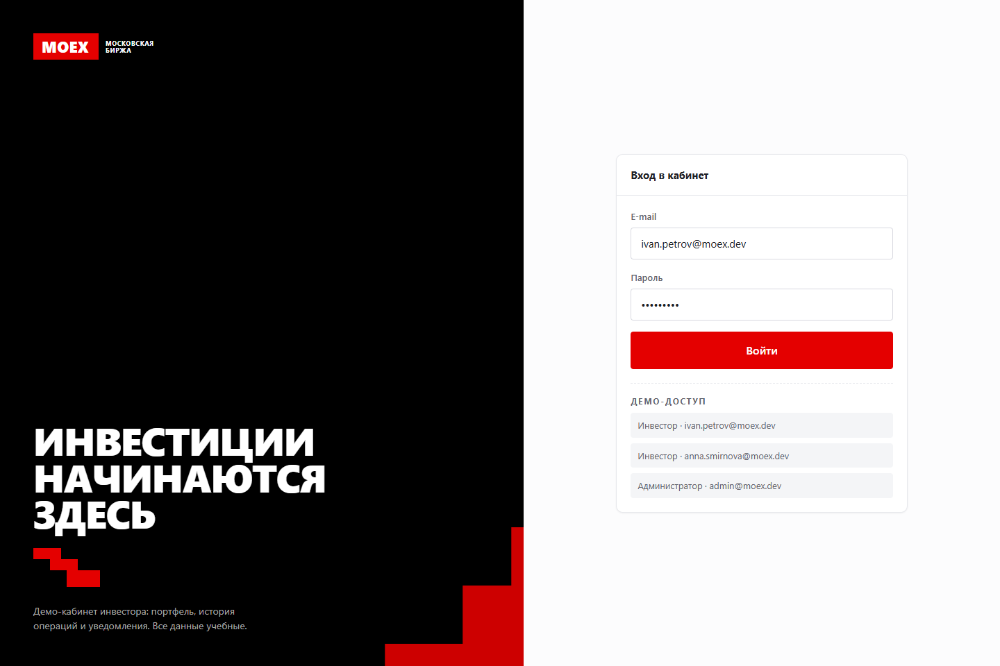
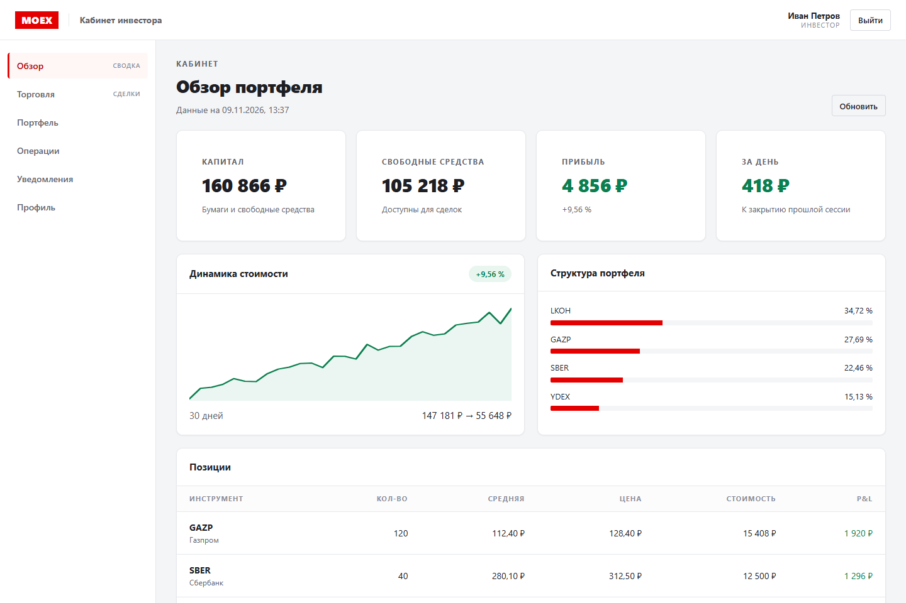
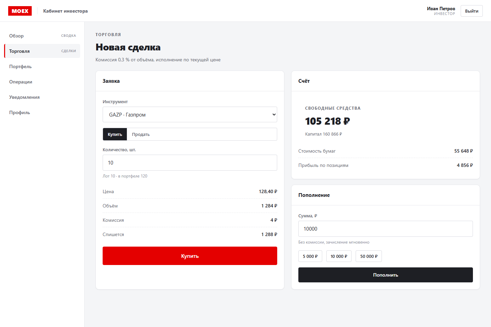
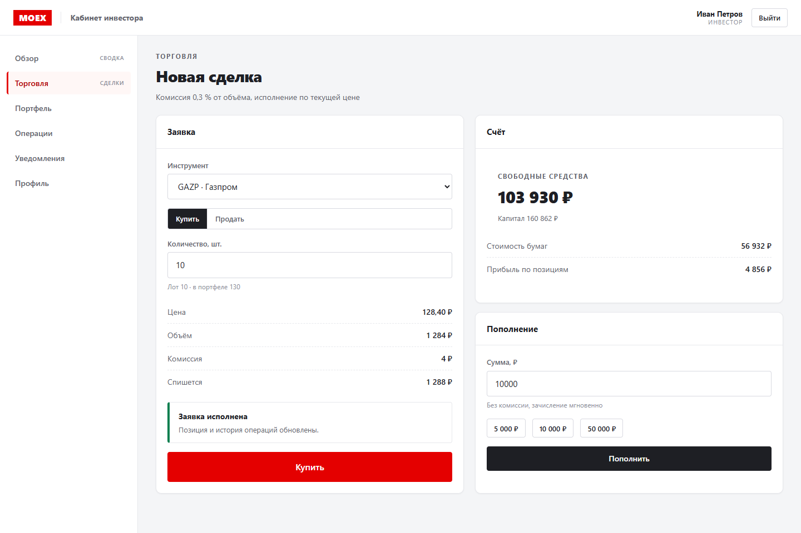
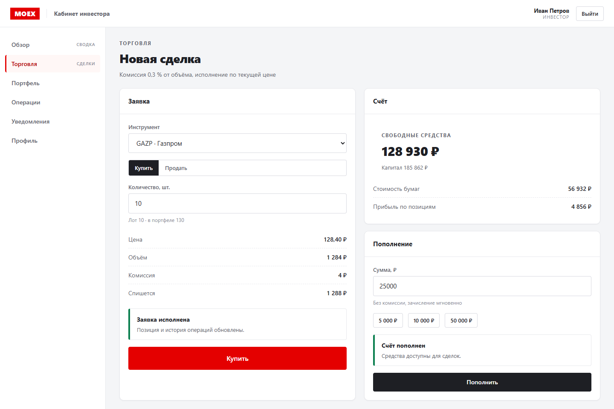
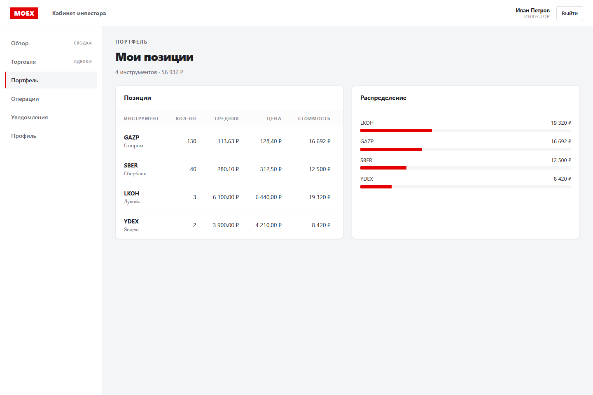
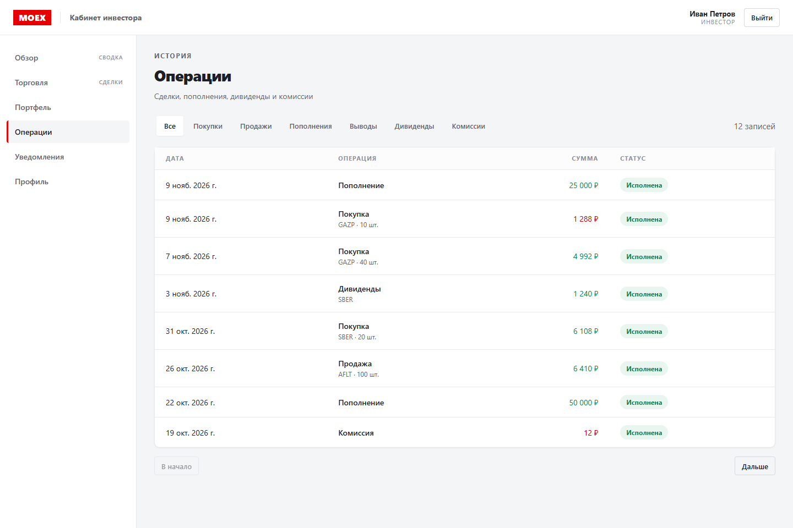
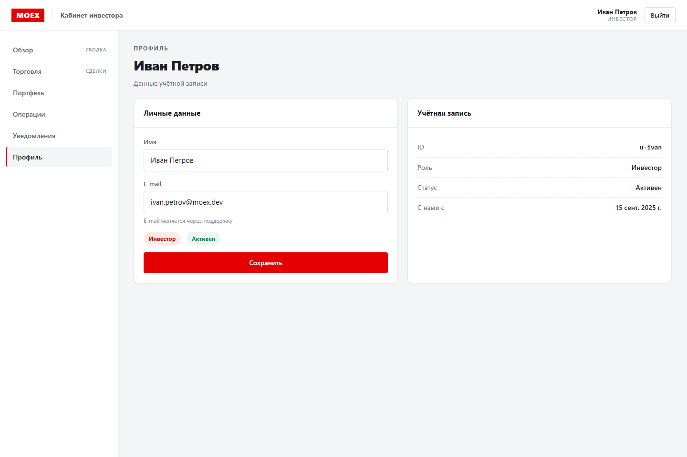
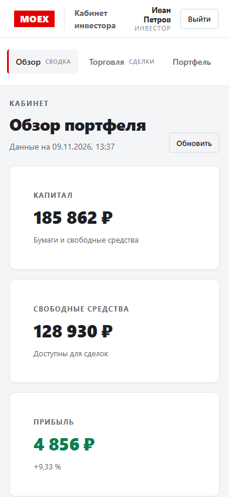
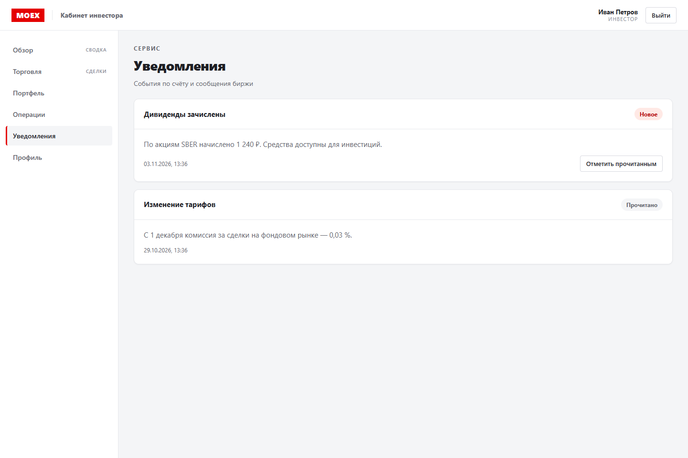

# MOEX Vibe Portfolio

Портфолио из **8 full-stack проектов** в стеке вакансии ПАО Московская биржа «Вайбкод-разработчик»:
React + TypeScript, REST и GraphQL, WebSocket, JWT/роли, SSR, тесты, дизайн-система и жёсткие
правила кода (один выход из функции, 1–2 оператора, без `break`/`continue`/`while`).

Все проекты живут в одном монорепо, используют общий UI-кит и общий серверный слой, но запускаются
и собираются независимо.

---

## Быстрый старт

Требуется Node.js 22+ (проверено на 26.13) и npm 11.

```bash
npm install
npm run dev
```

> На этой машине Node не был установлен, поэтому он распакован в `C:\Users\Admin\nodejs`.
> Если `node` не находится в PATH, добавьте эту папку или запускайте npm-скрипты из неё.

`npm run dev` поднимает API и фронтенд всех проектов:

| Проект | URL | API |
| --- | --- | --- |
| 01 · Личный кабинет инвестора | http://127.0.0.1:5101 | 4101 |
| 02 · Терминал котировок (WS) | http://127.0.0.1:5102 | 4102 |
| 03 · Платежи и история | http://127.0.0.1:5103 | 4103 |
| 04 · Администрирование | http://127.0.0.1:5104 | 4104 |
| 05 · SSR-лендинг + заявки | http://127.0.0.1:5105 | 5105 |
| 06 · GraphQL-витрина | http://127.0.0.1:5106 | 4106 |
| 07 · Калькулятор доходности | http://127.0.0.1:5107 | 4107 |
| 08 · Дизайн-система | http://127.0.0.1:5108 | 4108 |

Демо-доступы:

| Роль | E-mail | Пароль |
| --- | --- | --- |
| Инвестор | `ivan.petrov@moex.dev` | `Demo12345` |
| Инвестор | `anna.smirnova@moex.dev` | `Demo12345` |
| Администратор | `admin@moex.dev` | `Admin12345` |

Запуск одного проекта:

```bash
npm run server -w @moex/quotes   # API + WebSocket
npm run dev -w @moex/quotes      # фронтенд на 5102
```

---

## Скриншоты

Кабинет инвестора, 1440×960 — снято Playwright с живого приложения (`node scripts/shots.mjs`,
нужны запущенные API и Vite кабинета).

<p>
  
  
</p>
<p>
  
  
</p>
<p>
  
  
</p>
<p>
  
  
</p>
<p>
  
  
</p>

---

## Что внутри

### 01 · Личный кабинет инвестора
React SPA + Fastify REST + JWT (jose), роли, портфель, P&L, структура портфеля, история операций
с курсорной пагинацией, уведомления с отметкой о прочтении. Внутри — рабочая торговля: заявки
buy/sell с проверкой лота, свободных средств и остатка бумаг, комиссия 0,3 %, пополнение счёта,
редактирование профиля, капитал и свободные средства в обзоре.

### 02 · Терминал котировок
WebSocket-поток (`/ws`): снимок + тики каждые 1,1 с, переподключение с backoff, стакан из REST,
лента сделок, живой график. Тёмная тема терминала.

### 03 · Платежи
Пополнение и вывод, идемпотентность по `Idempotency-Key`, проверка карты по Луну, комиссия 1 %
(минимум 30 ₽), статусы `processing → settled/rejected`, поллинг истории.

### 04 · Администрирование
RBAC (`adminOnly`), смена ролей, блокировка пользователей, рассылка уведомлений аудиториям,
журнал аудита с пагинацией, статистика. Инвестор получает 403 на админских маршрутах.

### 05 · SSR-лендинг
Настоящий серверный рендер React (`renderToString`) + гидрация, SEO-мета и JSON-LD, приём заявок
через API. В dev — Vite middleware, в prod — собранные `dist/client` и `dist/server`.

### 06 · GraphQL-витрина
Схема на graphql-yoga: фильтры по сектору и поиску, сортировка, курсорная пагинация
(`edges/pageInfo`), превью запроса и переменных прямо в интерфейсе.

### 07 · Калькулятор доходности
Сложный процент с ежемесячной капитализацией, прогрессивный НДФЛ, комиссии. Расчёт на сервере,
Vitest-тесты на финансовую логику и API, Playwright-сценарии прогоняются отдельно.

### 08 · Дизайн-система
Токены (цвета, типографика, отступы, радиусы), каталог компонентов с живыми примерами,
модальное окно и тосты, свод правил кода. API отдаёт токены и каталог.

---

## Стиль

Визуальный язык снят с сайта moex.com: фирменный красный `#e40000` (и `#ff0508` для ховера),
чёрный `#000`, нейтральная шкала `#1e1f24 … #fcfcfd`, ступенчатый знак, крупные заголовки
капсом, табличные цифры, тонкие рамки.

Оригинальный шрифт биржи — **Favorit Pro** (коммерческая лицензия), поэтому в демо используется
системный гротеск: `"Golos Text", "Favorit Pro", "Segoe UI", …`. Токены и размеры подобраны под
фирменную типографику.

---

## Правила кода

Правила зашиты в ESLint и проверяются на всём репозитории:

| Правило | Как обеспечено |
| --- | --- |
| Один выход из функции | собственное правило `moex/single-exit`: ровно один `return`, и он последний оператор |
| 1–2 оператора на функцию | `max-statements: 2` (4 для React-хуков, off для тестов) |
| Без `continue`, `break`, `while`, `do/while`, меток | `no-continue` + `no-restricted-syntax` |
| Без ранних выходов и вложенных лестниц | `max-depth: 2` + `moex/single-exit` |
| Строгий TypeScript | `strict`, `noUncheckedIndexedAccess`, `verbatimModuleSyntax` |

Логика собирается из маленьких функций: предикаты, `map/filter/reduce`, тернарники вместо ветвлений,
композиция вместо процедур. Компоненты получают данные из одного хука и возвращают разметку.

---

## Проверки

```bash
npm run lint       # ESLint 10 + локальное правило single-exit — 0 ошибок
npm run typecheck  # tsc по пакетам и по проектам
npm run test       # Vitest: 15 тестов (финансы + API калькулятора)
npm run build      # сборка всех 8 проектов (+ SSR-сборка лендинга)
npm run e2e        # Playwright: сценарии калькулятора
```

E2E требуют установленного браузера:

```bash
npx playwright install chromium
npm run e2e
```

В текущем окружении браузер Playwright не установлен (ограничения по диску и памяти), поэтому
сами сценарии написаны и лежат в `e2e/`, но не прогонялись. Всё остальное — lint, типы, тесты,
сборки и ручные проверки API/WS/SSR — проверено.

---

## Структура

```
packages/
  ui/            дизайн-система: токены, компоненты, хуки, стили
  contracts/     типы, форматтеры, финансовая логика, валидация, пагинация, тесты
  server-kit/    Fastify-ядро: JWT, RBAC, in-memory store, WS-фид, рынок
projects/
  01-cabinet … 08-design-system
tools/
  eslint-plugin-moex/   правило «один выход»
  vite.base.ts          общий конфиг Vite с алиасами
scripts/
  dev.mjs               запуск всех сервисов
  build.mjs             сборка всех проектов
e2e/                    Playwright-сценарии
```

---

## Ограничения демо

Данные живут в памяти процесса и пересоздаются при рестарте; платёжный шлюз и рыночные котировки
сымитированы. Это учебное портфолио, а не инвестиционный сервис: ничто здесь не является офертой
или инвестиционной рекомендацией.
